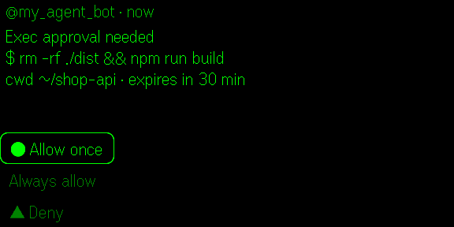
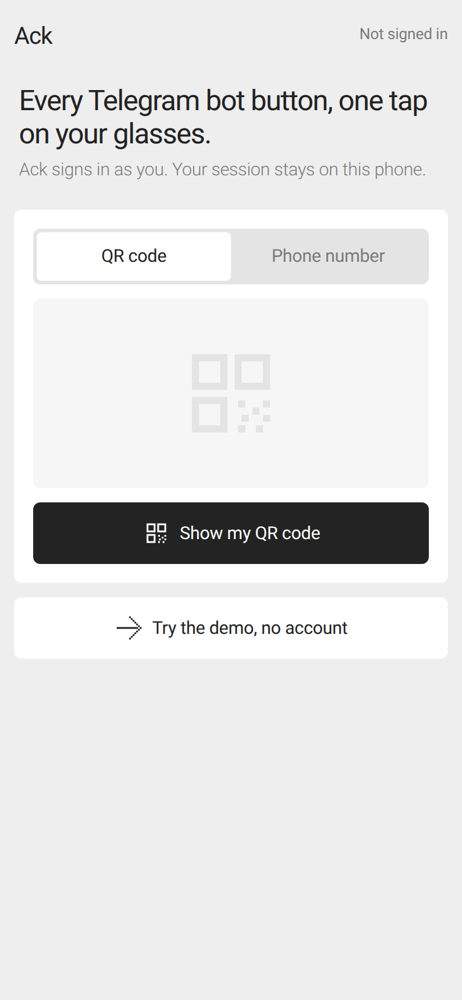
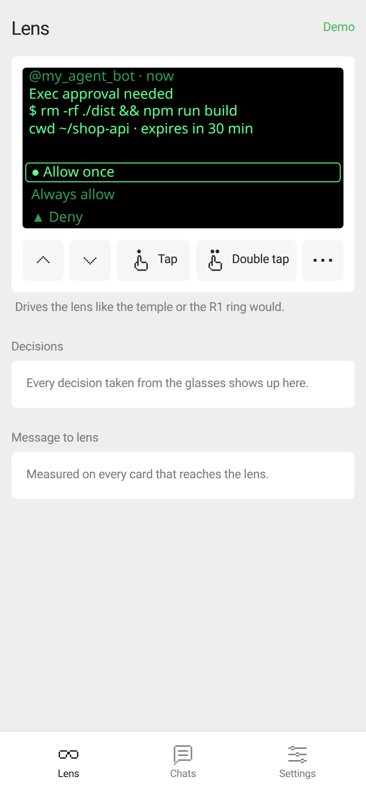
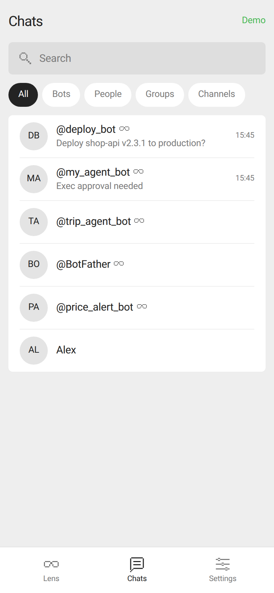
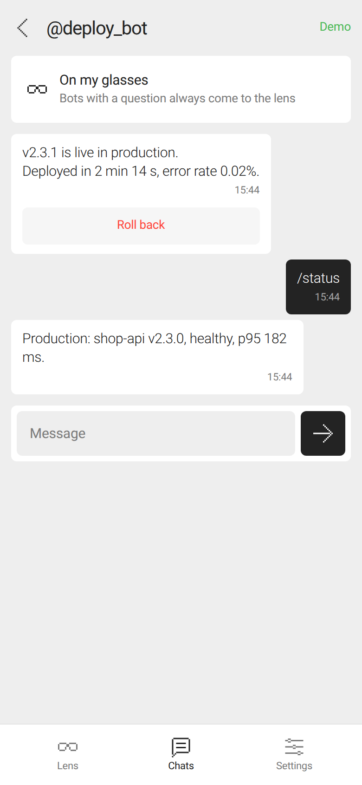
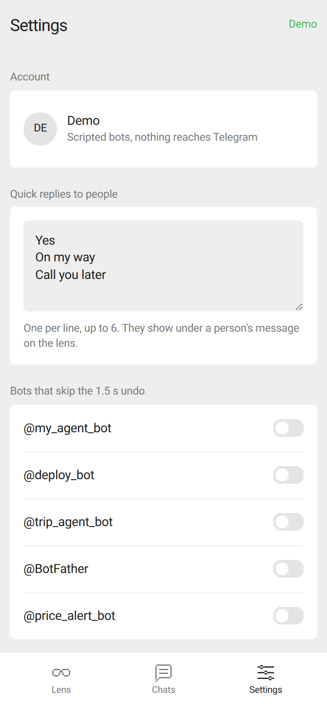
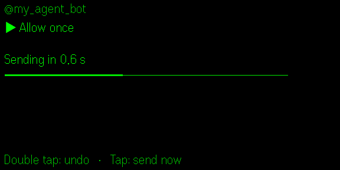
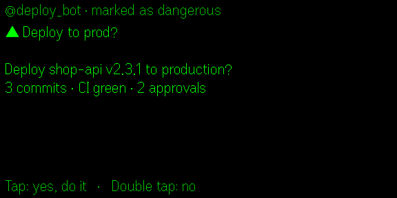
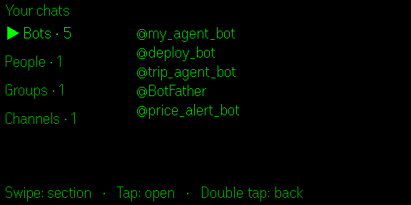

# Ack

**Taking back our eyes from our phones.**

**Every Telegram bot, one tap away on Even G2. Your phone stays in your pocket.**

On a real account, 21 of 21 public bots Ack had never seen reached the lens untouched, and a question lands there 9 to 62 ms after reaching your phone (Even Hub simulator). A tap on the temple or the R1 ring presses the button.

Ack is an unofficial Telegram client that uses the Telegram API, and it runs entirely inside the Even app on your phone.

Track: **01 Messaging & News** (Telegram accounts, bots, groups, channels) · Special prize: **Best Telegram integration**



## The problem

Bots now ask with buttons. AI agents send exec approvals to Telegram as inline buttons (OpenClaw does it natively, and the approval expires in 30 minutes). Deploy bots ask "Deploy to prod?", trading and travel bots ask "Book it for $212?". Since Bot API 9.4 (9 Feb 2026) a bot can even mark a button as `danger`, `success` or `primary`.

On Even G2, those messages only arrive as read-only notifications. To press "Allow once", you still have to take out the phone, unlock it, find the chat and tap. The decision takes a second. Getting to it takes thirty.

## What Ack does

- **Every bot, nothing to set up.** Ack signs in as you (your own Telegram account, from your phone) and turns every bot message into a card on the lens, alerts included, and its buttons into one-tap actions. BotFather, your agent, your deploy bot, your price alerts: all of them work as they are.
- **One tap.** Swipe to pick, tap to press. The bot's answer appears in the card header, and when the bot edits its message, the card follows. When the bot answers with a new message instead, that message replaces the card, so a button is never pressed twice.
- **Safe by design.**
  - Every press runs on a 1.5 s countdown you can undo with a double tap.
  - Buttons a bot marks `danger` always ask for an explicit yes and show what the card is about.
  - So do buttons whose label cannot be undone (delete, revoke, transfer, withdraw, pay, log out, in English and French), even when the bot marks nothing. Real bots rarely do: on a live account, BotFather's Delete Bot and Transfer Ownership carry no style at all.
  - Danger buttons are always listed last.
- **Numbers stay exact.** Emoji the glasses can't draw become words (✅ becomes "OK") or disappear. Digits, prices, addresses and commands are never changed, and a test checks it.
- **Buttons the lens can't run say so.** Links, Mini Apps and payments show "Finish on your phone" with the address. Copy buttons show their code, and disabled buttons are greyed.
- **People too, without becoming a chat client.** Only the people you pick come to the glasses, in the same queue. You answer with your quick replies or by voice.
- **Any chat from the lens, in a sidebar.** Tap the empty lens: your bots and the people, groups and channels you picked sit in sections on the left, and swiping moves through them while the chats of the chosen section show on the right. Tap opens a section, then a chat: its last messages come first, buttons or not (alerts, agent reports), with your quick replies for a person, then a bot's "/" menu: `/mybots`, `/deploy`, `/status`... The sidebar is also in the glasses menu of every card.
- **Voice when it is faster.** Hold, speak, release: "deny it" presses Deny. Anything else is sent as a message once you confirm. Transcription uses your own Groq or OpenAI key, kept on your phone.
- **A phone app in Even's own design language.** It follows Even's published app guidelines (colours, type scale, spacing, official pixel icons) and has three tabs:
  - **Lens**: the lens drawn to scale, which you can drive from the phone with tap, double tap and swipes when the glasses are not at hand, plus the log of every decision and the message-to-lens latency measured on every card.
  - **Chats**: your Telegram chats with avatars, unread counts, search and filters. Open one to read it, send a message or press a bot's buttons; a button the bot marks dangerous takes a second tap, as on the lens. One switch per person, group or channel sends their messages to the glasses.
  - **Settings**: Support Ack, quick replies, bots that skip the countdown, voice.
- **Sign in with a QR code** scanned from Telegram on another device, or with your phone number. Nothing else to set up: like iMe or Nicegram, Ack ships with its own Telegram api_id.

| Sign in | Lens | Chats | Chat | Settings |
| --- | --- | --- | --- | --- |
|  |  |  |  |  |

| Undo countdown | The bot answered | Danger needs a yes | Your chats |
| --- | --- | --- | --- |
|  |  |  |  |

## Try it in 2 minutes, no account needed

**In your browser, nothing to install: [4n0nn43x.github.io/ack](https://4n0nn43x.github.io/ack/).** The demo starts on its own. The black frame is what Even G2 shows, drawn to scale: drive it with the arrows, Tap and Double tap, like the temple or the R1 ring.

In the official Even Hub simulator, with Node 20 or later and no glasses:

```bash
npm install -g @evenrealities/evenhub-simulator
git clone https://github.com/4n0nn43x/ack && cd ack
npm install
npm run dev
# in a second terminal
evenhub-simulator "http://localhost:5173/?fresh"
```

Click the glasses screen once to start the **demo**. Scripted bots then behave like real ones: an agent asks for an exec approval, a deploy bot asks about production, a friend asks about tonight, a travel agent offers a flight, and a price alert fires. The simulator shortcuts are:

| Gesture | Glasses / ring | Simulator |
| --- | --- | --- |
| Pick a button | Swipe | Up / Down |
| Press | Tap | Click |
| Undo, dismiss, back | Double tap | Double click |
| Answer by voice | Hold, speak, release | Long press |
| Mute a chat, read all, clear | Tap then hold (system menu) | Context menu |

On Linux the simulator needs WebKitGTK: `sudo apt install libwebkit2gtk-4.1-0`.

## Use it with your Telegram account

1. Download `ack.ehpk` from the [latest release](https://github.com/4n0nn43x/ack/releases/latest) (or build it, see below), install it on the glasses through the Even Hub developer portal, and open Ack in the Even app.
2. Scan the QR code on the Ack page with Telegram on another device (Settings, Devices, Link Desktop Device), or enter your phone number and the code Telegram sends you. Nothing else to set up. The session is stored on your phone only.
3. To see bot buttons right away, run the real demo bot. It uses Bot API 9.4 button styles:

   ```bash
   BOT_TOKEN=<token from @BotFather /newbot> node tools/demo-bot.mjs
   ```

   Then send it `/approve`, `/deploy` or `/trip`. You can also open `@BotFather` from the lens and run `/mybots`.

On the glasses: `npm run pack` builds `ack.ehpk` (461 kB) for the Even Hub portal, or run `evenhub qr --url http://<your-ip>:5173` and scan the QR with the Even app.

Building from source: like the public repositories of iMe and Nicegram, this one holds no Telegram api_id. Get one at [my.telegram.org](https://my.telegram.org) ("API development tools") and put it in `.env.local` (copy `.env.example`; git ignores it). Vite injects it into your build. Without it, the Ack page asks for API keys before you sign in.

## Verify in 5 minutes

```bash
npm run verify   # types, 93 unit tests, production build, no API key in the repository
npm run e2e      # 9 checks on the real Even Hub simulator (start it with ?fresh and --automation-port 9898)
```

The end-to-end script drives the simulator through its automation API and reads what the lens shows. It checks:
- the sign-in screen;
- a bot question reaching the lens, with the latency;
- the undo countdown;
- the bot editing its message;
- the danger confirmation;
- an undo;
- the system menu.

```
Ack end-to-end on the Even Hub simulator
  ok 1. the lens shows the sign-in screen, never a black screen
  ok 2. tap starts the demo and a bot question reaches the lens
  ok 3. card on the lens 59 ms after the message arrived
  ok 4. pressing shows the undo countdown
  ok 5. the bot answers and edits its message, the card follows
  ok 6. OK clears the card, the lens is calm again
  ok 7. a dangerous button asks for an explicit yes, double tap backs out
  ok 8. double tap inside the countdown undoes the press
  ok 9. the contextual menu holds Ack actions
```

The unit tests check every page Ack can draw against the SDK's own validator (`validateEvenHubPageContainer`), and they also check the 63-byte list rows and the 1,000-character text limit.

Live proof on a real Telegram account, in [docs/proof/bots.md](docs/proof/bots.md) (`node scripts/bot-probe.mjs`): 21 public bots Ack was never told about answered `/start`, all 21 answers reached the lens as cards, and 31 of 31 of their buttons became lens actions. No bot button was pressed.

## How it works

```
Telegram (MTProto, layer 233) ──WebSocket──▶ phone: Even app WebView running Ack ──BLE──▶ G2 lens
      ▲                                       mtcute client, session in IndexedDB          ▲
      └──────── callback answer / message ◀── card queue, undo, confirm ◀── tap, swipe, ring, voice
```

No Ack server sits in between. The WebView talks to Telegram's web endpoints (`wss://*.web.telegram.org`) directly, and they are listed in `app.json`.

### Telegram surfaces used

| What | Where |
| --- | --- |
| User account login over MTProto: phone, code and 2FA, or QR code (`auth.exportLoginToken`) | `src/telegram.ts:46-48` |
| New, edited and deleted messages, live | `src/telegram.ts:51-53` |
| Pending bot questions brought back on start, followed chats, and the phone's chat list (dialogs) | `src/telegram.ts:58`, `src/telegram.ts:77`, `src/telegram.ts:114` |
| Chat history and read state (`messages.getHistory`, `messages.readHistory`), and read receipts for what the lens drew | `src/telegram.ts:122-123`, `src/telegram.ts:166` |
| Profile photos for avatars (file download) | `src/telegram.ts:133` |
| Press an inline button: `messages.getBotCallbackAnswer` | `src/telegram.ts:194` |
| Reply keyboards, quick replies and messages: send text | `src/telegram.ts:198` |
| Bot command menus (`botInfo.commands`) | `src/telegram.ts:227` |
| Official sponsored messages in channels and bot chats (`messages.getSponsoredMessages`, `viewSponsoredMessage`, `clickSponsoredMessage`), as the Telegram API terms (3.3) require | `src/telegram.ts:145`, `src/telegram.ts:156`, `src/telegram.ts:170`, `src/phone.ts:447` |
| Telegram Stars subscriptions read from the user's own account (`payments.getStarsSubscriptions`), for Ack+ | `src/telegram.ts:216`, `src/cards-from.ts:205`, `src/phone.ts:594` |
| Layer 233 inline buttons: callback, copy, disabled, url, web app, password | `src/cards.ts:83-86` |
| Bot API 9.4 button `style` (danger, success, primary) | `src/cards.ts:69-73` |
| Reply keyboard buttons (`keyboardButton`) | `src/cards.ts:91` |
| Callback toasts and alerts | `src/app.ts:242` |
| Rich messages | `src/cards-from.ts:167` |

### Even Hub SDK features used

| What | Where |
| --- | --- |
| Text and list containers, one page system with header, body and gesture hints | `src/app.ts`, `src/glasses.ts:65` |
| In-place text updates (`textContainerUpgrade`) when only texts change, else rebuild | `src/glasses.ts:137` |
| Native list selection, swipe handled by firmware | `src/glasses.ts:36` |
| Swipes read from a text container with event capture (`SCROLL_TOP` / `SCROLL_BOTTOM`) and brightness changed in place: the lens sidebar | `src/glasses.ts:42-43`, `src/app.ts:517` |
| Long press and release for voice (SDK 0.0.14+) | `src/glasses.ts:54` |
| Ring vs temple source on taps | `src/glasses.ts:28` |
| Contextual menu items (`menuObject`): mute, read all, clear | `src/glasses.ts:86`, `src/app.ts:188` |
| Text brightness levels (`textColor`) for hierarchy | `src/app.ts` |
| Glasses microphone (`audioControl`) | `src/glasses.ts:145` |
| Root double tap opens the system exit dialog (`shutDownPageContainer(1)`) | `src/glasses.ts:146` |
| Serialized bridge calls with a timeout | `src/glasses.ts:103` |

### Design rules on the lens

- Empty by default. The lens stays calm until a bot or a chosen person asks something.
- One card, one decision. At most three rows are visible, in the bot's order, with danger buttons last.
- Every screen has the same layout: who is asking (dim), the message (bright), what the gestures do (dim).
- Only glyphs the G2 font has are used (▲ ● ▶ ◁ □ ○ ━), and texts are fitted with Even's own font metrics (`@evenrealities/pretext`).
- Every gesture answers on the lens.

## Privacy and safety

The full policy, permission by permission, is in [PRIVACY.md](PRIVACY.md).

- Your Telegram session stays in the Even app on your phone. Ack has no backend, no analytics and no tracking.
- Signing out ends the session on Telegram's side and erases everything Ack keeps on the phone: session, settings and decision log.
- Ack only sees what your account already sees. People's messages reach the glasses only for the chats you pick.
- Ack follows Telegram's API terms: a message read on the lens is marked read in Telegram, as in any client (no ghost mode), and official sponsored messages appear, labelled, below a channel's posts and above bot chats on the phone, and after a channel post on the lens. Links outside Telegram ask before opening.
- Each press can be undone for 1.5 s, and bots you trust can skip the countdown in settings. Buttons a bot marks dangerous, or whose label cannot be undone, always ask for confirmation, on the lens and on the phone.
- Voice audio is captured only while you hold. It goes straight from your phone to the transcription service you chose, with your own key.
- The repository holds no secrets. Ack's Telegram api_id comes from `.env.local`, which git ignores, and is injected into the build, as iMe and Nicegram do. `npm run verify` and `npm run pack` fail if it ever lands in a file git would commit.

## Business model

**Ack is free, and what is free stays free.** No caps on bots, cards, chats or voice, no ads of our own on your eyes, no data sold. Other Telegram clients sell feature tiers or show their own ads. Ack locks nothing, and earns in Telegram's own currency:

| | Who pays | How it works |
| --- | --- | --- |
| **Ack+**, 250 Stars a month (live) | People who use Ack every day | A Telegram Stars subscription to Ack's private channel, from **Settings, Support Ack**. Telegram bills it, and Ack reads it from the user's own account (`payments.getStarsSubscriptions`), so there is still no Ack server. It unlocks nothing: it keeps Ack free and independent for everyone. |
| **Bot referrals** (next) | Bots, never the user | Telegram's affiliate programs pay a share of the Stars a user spends in a bot reached through a referral link. Bots that Ack suggests on the phone carry Ack's link, at no cost to the user. |
| **Ack for Teams** (next) | Companies whose agents and ops bots ask for approvals | A shared list of trusted bots and the decision log sent to the team's own systems, per seat. |

Stars are withdrawn in TON through Fragment, so every line feeds the Telegram and TON economy. As the Telegram API terms (3.2) ask, every way Ack makes money is listed in its store description.

## Project layout

```
src/cards.ts      Telegram message to card: buttons, styles, text cleaning, fitting (pure)
src/app.ts        queue, views and gestures (no SDK, no network: fully unit tested)
src/glasses.ts    pages to SDK containers, event parsing, serialized bridge
src/telegram.ts   live account over MTProto (mtcute)
src/demo.ts       scripted bots for the no-account demo
src/voice.ts      glasses mic to WAV to transcription
src/phone.ts      the phone app: sign in (QR or phone), Lens, Chats, chat view, Settings
src/icons/        official Even app icons used by the phone app
scripts/e2e.mjs   end-to-end checks on the simulator
scripts/bot-probe.mjs  live proof with real public bots (docs/proof/bots.md)
tools/demo-bot.mjs  a real Telegram bot with styled buttons
```

## Built during the hackathon

Everything in this repository was written from 23 Nov 2026. It started from the official `minimal` template of [evenhub-templates](https://github.com/even-realities/evenhub-templates) (first commit), and it uses these open-source libraries: [mtcute](https://github.com/mtcute/mtcute) (MIT), [uqr](https://github.com/unjs/uqr) (MIT) for the sign-in QR code, `@evenrealities/even_hub_sdk`, `@evenrealities/pretext`, Vite, TypeScript and Vitest. The phone app follows Even's published design guidelines, and its 22 icons are official Even app icons taken from [evenhub-app-ui](https://github.com/JustinasLa/evenhub-app-ui) (MIT, notice in `src/icons/`).

## License

MIT
